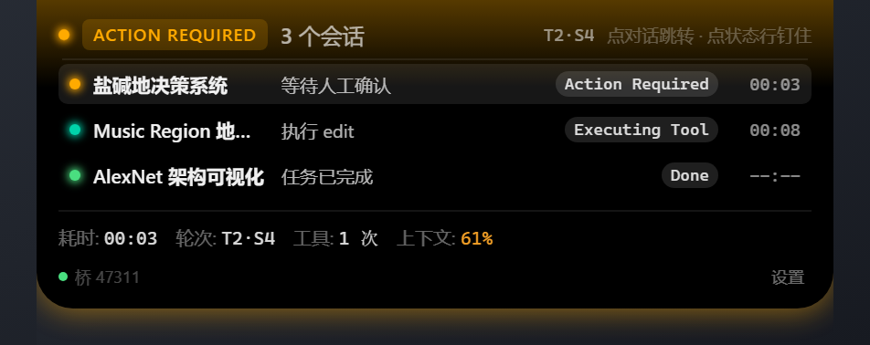
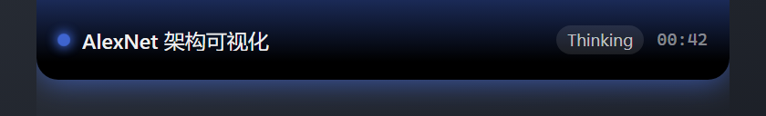
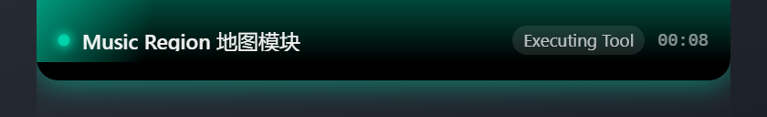
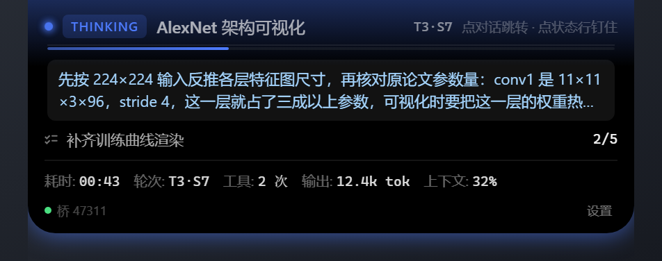
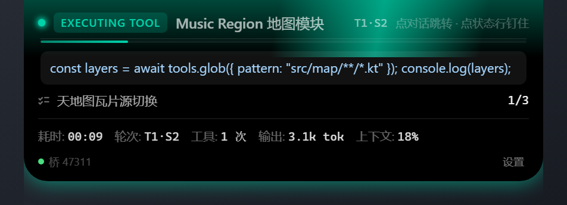

<div align="center">

# 🏝️ DSH DeepIsland

**专为 DeepSeek Harness 设计的双端原生灵动岛状态栏**

实时感知智能体状态 · 深度思维链解析 · 多会话并行监控 · 一键跳转交互

[](https://opensource.org/licenses/MIT)
[](#-平台支持)
[](https://github.com/qiyeren/dsh-deepisland/releases/tag/v1.5.0-rc.1)

<br>



<p align="center">
  <sub>在 macOS 物理刘海或 Windows 屏幕顶端居中悬浮窗显示智能体进度，点击可尝试跳转对应会话。</sub>
</p>

</div>

---

## 💡 为什么需要 DeepIsland？

使用 DeepSeek Harness 进行长链路工程任务时，智能体常在后台经历漫长的深度思考与工具调用。切屏确认进度不仅打断心流，更难以及时响应人工审批请求。

**DeepIsland** 将状态感知推向系统级前台：
- **物理刘海融合**：macOS 顶端原生刘海硬件融合；Windows 顶端无边框贴边悬浮（与 macOS 同一套视觉语言：纯黑底 + 状态色内发光带 + 沿剪影外发光）。
- **Windows 主岛（当前源码）**：只显示会话名和「运行中、待回答、回合完成、失败、中断」。普通工具调用或单个工具报错不改变回合状态。人工回答、审批与子岛上的 × 是不同操作：× 只隐藏提示，不算回答。
- **会话跳转**：点击状态栏尝试向 DSH 投递目标会话；是否实际打开取决于桥、客户端及宿主状态。
- **Windows 取数**：配套宿主维护有界的会话状态。原生端首次连接取摘要，之后通过本机 `GET /session-states?since=<rev>` 等变化，重连时重新取摘要。宿主不可用时不回退到扫描历史文件，也不把断线当作回合中断。宿主重新加载只从已挂载会话恢复（最多 64 个，每个最多回看内存中的 64 条记录）；很早且已不在恢复窗口内的待回答记录可能无法补出，不会为了补齐而重读历史。原生端单独重连则直接拿宿主现有摘要。macOS 不订阅这条状态流。

---

## 📸 历史版本状态展示

以下截图记录旧版布局，不是当前 Windows 五态界面；当前源码不在主岛显示工具名、执行参数、思考内容或耗时统计。

### 1. 紧凑折叠态（Compact Mode）

屏幕顶端常驻，以色彩与微动效呈现智能体实时动作，不遮挡日常视线：

| 💭 深度思考 | ⚡ 工具执行 | 🔀 多会话并行 |
| :---: | :---: | :---: |
|  |  |  |
| 实时截取思维链要点（蓝光） | 显示当前工具与操作文件（青光） | 显示优先级最高会话 + 数量角标 |

### 2. 悬停展开态（HUD Mode）

鼠标悬停 0.2s 平滑展开，显示耗时、轮次、工具调用数、Token 消耗及多任务列表：

| 单会话深度监控 | 工具调用与耗时 | 多任务并行调度 |
| :---: | :---: | :---: |
|  |  |  |
| 进度条、思考耗时、上下文量 | 实时显示执行命令与参数 | 按优先级排序，点击切换聚焦 |

---

## ⚡ 核心功能

- **Windows 多会话**：最多显示 6 条会话，等待人工操作的会话优先；展开时仍只看会话名和状态。终态短暂保留后从列表移除，不代表删除会话。
- **等待人工处理**：有会话确实在等回答或审批时优先展示「待回答」并展开；只发起普通工具调用不会唤起主岛。
- **Windows 界面**：收起态高 14px，有会话时宽 211px；会话行已过期、但还留着「已完成」提醒时，收起态显示那条提醒的会话名和「回合完成」，仍是 211px。既无会话也无提醒时，「暂无会话」和断线提示按文字宽度加左右各 8px 居中显示。展开态宽 350px（100% 缩放），展开主岛即可看到会话和普通提醒，无需再点分类，工具名、推理文本、用量和计时不再出现在主岛。
- **本机跳转请求**：通过本机回环桥提交请求，由 DSH 客户端尝试打开目标会话；入队成功不等于实际打开成功。
- **结束判定**：正常结束才算回合完成；回合报错或被策略阻止算失败；用户停止或输出被长度上限截断算中断。桥断开、状态不明不会伪造结束事件。
- **Windows 紧急子岛**：主岛下方显示等待处理或执行失败的会话，等待优先，并按会话去重显示其他会话数量。紧急提醒由子岛呈现，不在主岛提醒区重复显示；无法定位会话的紧急提醒仍保留在主岛。点击后，仅在跳转请求成功入队时本地隐藏当前事件并显示下一条，不确认或删除服务器提醒；入队不保证会话已打开，跳转失败时仍保留。隐藏状态仅在当前进程内有效，重启后未过期提醒可能再次显示；新事件可再次出现。会话实时等待状态不受提醒静音开关控制。该功能尚需实际桌面验收。
- **三种「该你处理了」时刻**（本 fork 的 Windows 源码融合自 [`HalfDone03/dsh-nudge`](https://github.com/HalfDone03/dsh-nudge)）：回合**完成**、**等你批准或回答**、**执行失败**时，可在岛体显示提醒；主岛普通提醒点击时，先尝试提交会话跳转，仅请求成功入队后才确认对应提醒；子岛不发送确认。入队不等于会话已打开。原插件采用一次性 WPF 卡片；此处不对其资源占用或启动时间作未经验证的量化。macOS 尚未适配提醒，全屏抑制未实现。详见 [`docs/nudge-fusion.md`](./docs/nudge-fusion.md)。

---

## 🚀 快速安装

> **版本与发布说明**：以下安装地址和 Release 链接指向上游，并非本 fork。Windows 原生端与宿主须配套：本 fork 包含 [`windows/artifacts/dsh-notch-paired.asar`](windows/artifacts/dsh-notch-paired.asar)，宿主只会请求启动与其 SHA-256 一致的已安装 asar，不会自动下载上游 Windows 程序。替换前须先安全退出原生岛并备份原文件；不能在运行时假定旧进程已更新。此校验只比对磁盘 asar，不证明 exe 或已运行进程身份。源码改动不代表本机已更新或经过真实运行验证。

### 上游安装方式（不等于安装本 fork）

插件充当控制面与本机通信桥，并负责应用端缺失时的静默自愈安装。

1. 打开 **DSH Desktop** → **插件管理**。
2. 输入完整 Git 仓库地址并安装：
   ```text
   git+https://github.com/myYangyunfan/dsh-deepisland.git
   ```
3. 在安装完成弹窗中点击 **「立即启用」**（写入 `dsh.profile.bundles` 配置）。
4. **重启 DSH Desktop**。插件加载后将自动下载校验对应系统的原生应用，数秒后灵动岛即刻呈现。

<details>
<summary><b>🔍 验证安装状态</b></summary>

在终端执行健康检查命令：
```bash
curl -s http://127.0.0.1:47311/health
# 成功响应仅说明有服务应答；不证明服务身份或会话跳转成功
```
</details>

<details>
<summary><b>🛠️ 备用方案：手动编译安装独立应用</b></summary>

无需插件控制面亦可独立运行原生灵动岛（仅失去一键跳转能力）：

**macOS 原生构建：**
```bash
cd swift
./build.sh install
```

**Windows 便携部署：**
从 [Releases](https://github.com/myYangyunfan/dsh-deepisland/releases) 下载最新发行版压缩包，解压至 `%LOCALAPPDATA%\Programs\DSHNotch\` 即可。

详见 [`swift/INSTALL.md`](./swift/INSTALL.md) 与 [`windows/README.md`](./windows/README.md)。
</details>

---

## 🎮 交互指南

| 触发操作 | 响应动作 | 说明 |
| :--- | :--- | :--- |
| **悬停 0.2 秒** | 展开 HUD 面板 | 查看上下文 Token、工具详情及多会话列表 |
| **移出 0.35 秒** | 收起面板 | 平滑淡出，不干扰主屏幕操作 |
| **单击岛体空白处** | 锁定 / 解锁常驻 | 常驻状态下鼠标移开不会自动收拢 |
| **单击会话条目** | 尝试跳转会话 | 发送请求；入队不代表 DSH 已打开该会话 |
| **右键岛体** | 原生菜单 | 钉住/取消、隐藏、打开 DSH 设置、打开配置目录、退出（Windows v2） |
| **HUD 键盘** | `↑/↓` 选行、`Enter` 跳转、`Esc` 取消钉住 | 键盘可达性与焦点环 |
| **托盘 / 菜单栏图标** | 系统级控制菜单 | 快速开关灵动岛、开机启动项、重载配置 |

---

## ⚙️ 配置说明

配置文件位于各系统标准应用数据目录的 `client-config.json` 中：
- **macOS**: `~/Library/Application Support/DSHNotch/client-config.json`
- **Windows**: `%APPDATA%\DSHNotch\client-config.json`

Windows 端约每 2 秒检查配置文件是否变化，无需重启；会话状态更新不等待这个周期：

| 参数名 | 类型 | 默认值 | 描述 |
| :--- | :---: | :---: | :--- |
| `notchEnabled` | boolean | `true` | 全局开关：是否显示屏幕顶端灵动岛 |
| `jumpEnabled` | boolean | `true` | 是否启用点击一键跳转会话功能 |
| `hideWhenIdle` | boolean | `false` | 智能体进入待命状态后是否完全隐藏岛体 |
| `glowEffect` | boolean | `true` | 思考与工具调用时的边缘流光光晕动效 |
| `expandOnHover` | boolean | `true` | 是否允许鼠标悬停自动展开 HUD 面板 |
| `scale` | number | `1.0` | 界面整体缩放比例（支持范围 0.5 ~ 2.0） |
| `placement` | string | `"notch"` | 放置模式：`"notch"` (顶部吸附) / `"floating"` (悬浮) |
| `platformMode` | string | `"auto"` | 视觉风格：`"auto"` / `"macos"` (黑晶) / `"windows"` (亚克力) |
| `showSubagentCount` | boolean | `true` | 并行子代理运行时是否显示右侧数字角标 |
| `bridgeEnabled` | boolean | `true` | 本机回环通信服务开关（仅影响跨进程跳转） |
| `bridgePort` | number | `47311` | 本机桥端口；冲突时停止启动，不自动顺延或复用未知桥；`47312` 保留为所有权哨兵，不可使用 |
| `autoInstallApp` | boolean | `true` | 控制原生应用自动安装流程。Windows 不会下载上游原生端，只会尝试启动已安装且 asar 哈希匹配的配套版本；仅版本号相同不能证明配套。 |

### 提醒（融合自 dsh-nudge）

| 参数名 | 类型 | 默认值 | 描述 |
| :--- | :---: | :---: | :--- |
| `nudgeEnabled` | boolean | `true` | 提醒总开关（关掉后岛体一条都不显示） |
| `nudgeOnChoice` | boolean | `true` | 等你批准 / 回答时提醒 |
| `nudgeOnFailed` | boolean | `true` | 回合失败（`error` / `blocked`）时提醒 |
| `nudgeOnCompleted` | boolean | `true` | 回合完成（含 `max-tokens` 截断）时提醒 |
| `nudgeAlertOnToolError` | boolean | 已停用 | 旧配置保留兼容；单次工具失败不再单独生成提醒 |
| `nudgeMuteRanges` | string | `""` | 静音时段，`HH:MM-HH:MM`，逗号分隔多段，支持跨零点（如 `22:00-08:00`）；留空 = 不静音 |
| `nudgeMaxItems` | number | `4` | 岛上一屏最多显示几条（1–8） |
| `nudgeMergeWindowMs` | number | `1200` | 同一会话同一类别的重复事件在窗口内合并、累加计数并轮换 UUID |
| `nudgeTtlMinutes` | number | `30` | 一条提醒最多留多久，超时自动丢弃 |

`session/event` 中的 `aborted`（用户主动停止）不提醒；会话事件对 `parentSession` 或 `delegationDepth > 0` 的子代理进行过滤。审批与提问路径不套用该过滤，因此子代理的待选择请求仍可能触发提醒。

---

## 🏛️ 体系架构

系统解耦为 **插件控制面** 与 **原生呈现宿主**，两者通过回环接口解耦交互：

```
┌────────────────────────────────────────────────────────┐
│                   DSH Desktop Host                     │
│  ┌──────────────────────┐    ┌──────────────────────┐  │
│  │   UI / Workspace     │    │   Session Storage    │  │
│  │ (openSession Hook)   │    │ (*.jsonl.zstd 流追加) │  │
│  └──────────▲───────────┘    └──────────┬───────────┘  │
└─────────────┼───────────────────────────┼──────────────┘
              │ 同源 API /next             │ 增量多帧解压
┌─────────────┴───────────┐               │
│  插件控制面 (127.0.0.1)  │               │
│  (端口 47311 / IPC 桥)   │               │
└─────────────▲───────────┘               │
              │ POST /jump                ▼
┌─────────────┴──────────────────────────────────────────┐
│             原生状态栏端 (Swift / Electron)             │
│        - ActivityCursor 增量游标 (Multi-frame Zstd)     │
│        - 弹簧物理动效渲染 (Spring Dynamics)             │
└────────────────────────────────────────────────────────┘
```

<details>
<summary><b>🔬 核心技术点解析</b></summary>

1. **多帧级联 Zstandard 流解包**：DSH 采用追加模式写入压缩事件流，由多个独立的 Zstd 帧顺序拼接组成（魔数 `0x28 0xB5 0x2F 0xFD`）。基础单帧解压器仅解析首帧会导致大量后续事件丢失。DeepIsland 实现了帧边界探测与级联重组算法，确保事件流零截断。
2. **状态仲裁双重通道**：以高实时性事件流（`ActivityCursor`）为主通道，在会话读写锁冲突或文件不完整时，自动切换至宿主投影文件（`inferFromProjection`）进行状态补间，并在回合终结时以 `sawTurnEnd` 机制抑制幽灵唤醒。
3. **尽力跳转**：原生端通过 `POST /jump` 入队；DSH 客户端从同源 API 取出请求并尝试调用 `ctx.uiWorkspace.openSession`。入队回执不是实际打开的确认，断线、队列过期、客户端停用或打开失败都可能导致未跳转。

当前工作区的桥接调整仍在开发：浏览器配置读写通过 DSH 同源、受宿主信任与会话认证保护的 `/api/dsh-vibe-island/config`，取队列通过同源 `POST /api/dsh-vibe-island/next`；这些路由依赖宿主保护，本身不实现认证。原生桥仅绑定 `127.0.0.1`，要求 `Host` 为实际 `127.0.0.1:端口`，拒绝带 `Origin` 或 `Sec-Fetch-*` 的请求；这只是降低浏览器来源攻击，不是身份认证，本机进程仍可伪造请求。桥所有权或端口冲突按设计停止启动，不回退到未知桥或其他端口；旧版本不一定参与所有权约束。以上为源码意图，不代表运行版本已验证。

</details>

---

## 💻 平台支持

| 平台 | 实现语言 | 视觉形态 | 系统兼容性 |
| :--- | :--- | :--- | :--- |
| **macOS** | Swift + AppKit (`NSPanel`) | 物理刘海吸附融合 | macOS 13.0 (Ventura) 及以上，原生适配 Apple Silicon / Intel |
| **Windows** | Electron + HTML5 / CSS3 | 顶端无边框悬浮窗（纯黑底 + 状态光，与 macOS 同语言） | Windows 10 / 11 64-bit |

---

## 🧪 开发与测试

仓库提供插件端和原生端测试。**注意：旧版插件端默认测试入口尚未完成全面隔离，不要在正在使用的 DSH profile 或生产桥环境中运行；部分测试可能访问本机配置或桥。** 下方旧入口仅适用于隔离环境。新增安全回归测试须单独执行，不能假设旧入口已覆盖它们。

```bash
# 1. 仅在彻底隔离的环境中运行旧版插件端测试
node test/run.mjs all

# 2. 运行 Windows 原生端回归测试（507 项 + 提醒数据层/UI 新增套件）
cd windows && npm test

# 3. 运行 macOS 原生端测试套件
cd swift && ./build.sh all-tests

# 4. 驱动真实渲染层生成 2x 高清实机状态截图
cd windows && npm run shots

# 5. Windows 渲染层性能基准（与仓库基线对比；数字必须同机、同显示模式看）
cd windows && npm run perf
```

> 提醒相关的两套自检可以单独跑：`node test/test-nudge.mjs`（事件语义：`turn/end`
> 五种 kind 怎么判、单次工具失败不提醒、审批链必须放行、`userQuestions` 包装必须还原）
> 与 `node test/test-nudge-bridge.mjs`（`GET /nudges` / `POST /nudge/ack` 的端到端行为）。
> 分开的理由是：桥起不来时语义层仍然是对的，混在一起会让「哪一层坏了」看不出来。

---

## ❓ 常见问题 (FAQ)

<details>
<summary><b>Q: 插件安装完成后，屏幕顶端没有出现灵动岛？</b></summary>

通常是因为宿主环境尚未加载该插件。DSH Desktop 安装插件后，需确保点击插件卡片上的 **「立即启用」** 将其载入 `dsh.profile.bundles`，随后**彻底重启 DSH Desktop**（必须退出进程重开，仅关闭主窗口无效）。
</details>

<details>
<summary><b>Q: 点击会话条目无法跳转到 DSH 窗口？</b></summary>

1. 确认 DSH 设置中 `jumpEnabled` 为开启状态；
2. 确认控制面端口 `47311` 未被第三方安全软件拦截；
3. Windows 端因系统权限限制，若主窗口处于最小化托盘状态，可配合任务栏切换后使用快捷键定位。
</details>

<details>
<summary><b>Q: 自动下载原生程序时提示网络失败？</b></summary>

插件内置智能代理感知模块，会自动尝试读取系统 `HTTP_PROXY` 与 `HTTPS_PROXY` 环境变量走隧道下载。若网络受限，可根据上方说明手动下载 Release 产物放置于目标目录，插件检测到已有可执行文件会自动跳过下载步骤。
</details>

---

## 📄 开源许可证

本项目基于 [MIT 许可证](./LICENSE) 开源。
Copyright © 2025-2026 Yangyunfan. All rights reserved.
