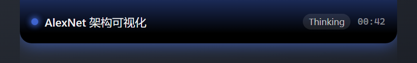
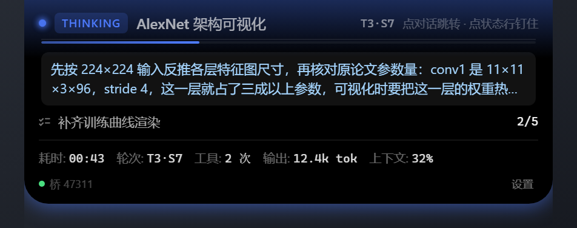

# DSH Notch for Windows

> **Fork 预发布提示（2026-11-19）：** 本文下方部分构建、自动下载安装和真机验证描述是历史记录，不代表当前 fork 已完成同等验证。当前插件只启动哈希匹配的配套原生端，不会自动下载上游版本。最新发布包和已验证范围请以 [fork 的 Release 页面](https://github.com/qiyeren/dsh-deepisland/releases)为准。

**当前开发版：** Windows 主岛只显示会话名和五个状态：运行中、待回答、回合完成、失败、中断。主进程通过 `src/state-feed.js` 从本机宿主获取摘要；正常运行时不枚举会话目录、不解压历史日志。普通工具事件不更新主岛，断线也不冒充中断。历史监视器仅用于离线诊断。100% 缩放时，主岛收起高 14px，展开宽 350px；展开时下方的 330px 子岛居中。保留拖动位置和子岛手动关闭。

**如何复测五态版本：** 在仓库根目录执行 `node windows/scripts/bench-status.mjs paired 24`（Windows，需本地已安装 Electron 依赖）。脚本用同一批 782 个合成会话，按旧版→新版→新版→旧版的顺序，各测 24 秒空闲与连续工具事件，检查状态是否真正送到渲染层。输出的 `oneCorePct` 是 Electron 主进程、渲染进程与模拟宿主的合计单核等效占用，不是任务管理器的整机占比。测试不连接实际 DSH，不测真实桌面合成或其他插件。

**以下为旧版实现和历史验收记录。** 文中的合成状态图、秒表、自适应轮询和性能数字用于解释旧版，不是现行五态版本的界面或实测结果。

> 历史版从数据层扩展到 UI、托盘、跳转和打包。下表区分了当时已验证的路径和未完成的验证；不列出测试设备上的会话内容。
>
> 2026-10-18 完成 v2 全方面优化（动画 / 界面 / 交互 / 性能）：真弹簧曲线、
> 分层入场、状态动效、增量渲染、快照 DTO + rev 去重、ResizeObserver 高度、
> 穿透看门狗、右键菜单与键盘导航。契约与验收数据见本文「性能基准」一节。

## 现在有什么

```
windows/
├── README.md              ← 你在这里
├── package.json           Electron 壳（独立子项目，不受根 package.json 的 type:module 影响）
├── assets/                icon.png / tray.png / icon.ico（make-icons.js 生成，零依赖）
├── scripts/
│   ├── dev.js             npm start 的启动器（必须先清掉 ELECTRON_RUN_AS_NODE）
│   ├── make-icons.js      手写 PNG/ICO 编码器
│   ├── make-sums.js       给 dist 产物算 SHA256SUMS.txt（格式与插件 parseSums 对齐）
│   ├── probe.js           喂真实 ~/.dsh 数据，打印 monitor 的判定结果（排障用）
│   ├── shots.js           README 状态图生成器（驱动生产渲染层，v2 DTO 合成快照）
│   └── perf.js            渲染层性能基准（帧/CPU/DOM/快照；--src 可对基线副本跑）
├── src/
│   ├── session-source.js  ✅ 会话发现 + zstd 解压 + 事件解码
│   ├── projections.js     ✅ 读 DSH 的投影快照 + 宽松解析
│   ├── config.js          ✅ 读 client-config.json（与 macOS 版同一份协议）
│   ├── activity.js        ✅ Activity / ActivityCursor 移植（状态机 + 文本抽取）
│   ├── monitor.js         ✅ SessionMonitor 移植 + 事件游标优先 / 投影兜底
│   ├── bridge.js          ✅ 本机跳转桥的客户端半边（POST /jump、GET /health）
│   ├── jump.js            ✅ 跳转流程（置前 → 投桥 → 剪贴板降级）
│   ├── snapshot.js        ✅ 快照协议 v2（纯函数 DTO / rev 去重 / nextDelay 自适应）
│   ├── main.js            ✅ 主进程：无边框置顶小窗 + 托盘 + 自适应轮询 + 穿透看门狗 + IPC
│   ├── preload.js         ✅ contextBridge 暴露最小能力（不开放 node）
│   ├── index.html         ✅ 岛的骨架（骨架只创建一次，之后由 renderer 增量更新）
│   ├── styles.css         ✅ 折叠条 / 展开面板 / HUD（真弹簧 + 分层入场 + 状态动效）
│   └── renderer.js        ✅ 渲染逻辑（增量更新 / 本地秒级时钟 / ResizeObserver 高度）
└── test/                  ✅ 9 个套件，507 项断言 + e2e 26 项
```

## 真机验证结论

环境：Windows 11（内部版本 26200）、Electron **44.7.0**（Node **24.21.0** / Chromium 152）。

| 项 | 结果 |
| :--- | :--- |
| 自测（数据层 + 状态机 + 桥 + 跳转 + 快照协议 + 入口契约 + v2 动效/性能契约） | **507 通过 / 0 失败**（9 套件，`node test/run.js`） |
| 隔离 profile 的冒烟测试 | ✅ 检查折叠和展开两态是否渲染、内容是否裁切，以及进程退出码；发布文档不附真实会话的渲染文本和截图 |
| 渲染层性能基准 | ✅ `scripts/perf.js` 对基线副本与当前 src 同机对比（见「性能基准」一节） |
| 无边框置顶小窗 | ✅ 常驻顶部，跨桌面不被遮挡 |
| 托盘 + 右键菜单 | ✅ 显示/隐藏、开机自启、桥状态、打开配置目录、打开 DSH 设置、退出 |
| 点击会话行 → 换会话 | ⚠️ **协议侧 5 段已端到端跑通**（e2e 26 项）；真实 `openSession` 需本机跑着 DSH 才验得了 —— 见下 |
| 打包 | ✅ `dist/DSHNotch-<ver>-win-x64.zip` + NSIS 安装包 |
| **zip 解压即跑** | ✅ 历史版用 `Expand-Archive` 解压后启动 exe；冒烟输出字段为渲染文本、窗口尺寸、会话数 |
| NSIS 安装向导 | ⚠️ 产物生成正常，静默安装**没跑通**（`/S` 后进程挂着没落地），未实测 |
| 旧版插件服务端自动安装 | 逻辑有 38 项断言；未完成真实下载验证 |
| 插件能被 DSH 加载 | ✅ 历史测试导入入口用时 26 ms，检查了 `apply`、`inject` 等导出 |

## 外形与架构：macOS 版的同款结论




这两张图使用 `scripts/shots.js` 为旧版渲染层构造的固定示例会话，仅展示当时的布局与状态。它们不是用户会话截屏，也不代表现版五态主岛。

macOS 上物理刘海是个方角矩形缺口，岛是它的延伸。Windows 没有刘海，
直接画个悬浮药丸只会像贴了膏药 —— 缺了「它从屏幕顶部长出来」这个视觉锚点。

做法照搬 `swift/UI/NotchShape.swift` 的结论：**窗口顶端与屏幕（工作区）
顶端重合，岛体顶边平直、两个方角落在屏幕边界上**，整体就读作「从屏幕
边缘长出来的一块」。实现是两处协作：

| 文件 | 做什么 |
| :--- | :--- |
| `main.js` | 窗口 `y = workArea.y`（顶端贴屏）、尺寸恒为 `MAX_WINDOW` |
| `styles.css` | 岛体只有底部圆角（`border-radius: 0 0 12px/20px`），在窗口里顶端居中 |

### 为什么动画是丝滑的（架构分水岭）

窗口按**最大展开态**一次开好（`MAX_WINDOW`，多出的 bleed 给外发光留
绘制空间），展开收起只是岛体在窗口里改宽改高 —— CSS 弹簧、合成器动画，
窗口一个字节不动。旧版「逐帧 setBounds 跟内容」的路子在 DWM 上必然抖：
层化透明窗口的尺寸变化走不了合成器快路径。这正是 macOS 版
（`NotchPanel` 按最大展开态开窗、`NotchMetrics.maxExpandedSize`）丝滑
而旧 Windows 版发涩的分水岭。

窗口平时**鼠标穿透**（`setIgnoreMouseEvents(true, {forward:true})`），
转发的 mousemove 在渲染层对岛体**当前**矩形做命中：进岛临时接管
（行/按钮可点、可拖动），出岛立刻恢复穿透 —— 比岛大一圈的透明区域
不吞下方应用的点击。等价于 macOS 版 `NotchPanel.isInteractive`。

这些不变量由 `test/setup-entry.test.js` 的 **S8/S11 组**钉住（固定窗口、
贴屏、穿透默认、旧 resize/expand 通道不得回流、渲染热路径零同步布局）。

### v2 渲染层：为什么「能看但发涩」被修掉了（2026-10 全方面优化）

旧版每拍快照都 `innerHTML` 重建整块界面。而快照里有 `now`/`mtimeMs`，
主进程的「整包 JSON 比较」因此每拍都判定「变了」→ **4 次/秒**销毁重建全部
节点：展开动画每 340ms 被打断一次、点过的会话行被抽走、每拍还两次
`offsetHeight` 强制同步布局。界面「能看但发涩」的根源在渲染路径，不在 CSS。

v2 的五条纪律（都由测试按源码钉住，见 `test/setup-entry.test.js` S11/S12）：

1. **快照 DTO + rev 去重**：快照只含渲染层真会读的字段（`src/snapshot.js`），
   `rev` 由内容稳定序列化算出、不含 `serverNow`；主进程 rev 没变就不发，
   渲染层收到相同 rev 直接跳过整次渲染。
2. **增量更新**：骨架只创建一次，之后按 id 复用会话行、统计行走固定槽位，
   所有写入先比较旧值（`textContent`/class/自定义属性同值不写）。
3. **零同步布局**：高度不用 `offsetHeight` 量，改由 `ResizeObserver` 观察
   `.island-body` 把自然高度写进 `--island-h`，CSS 负责过渡；全渲染层只剩
   命中判定（脏标记 + rAF + 1s 兜底）一处 `getBoundingClientRect`。
4. **本地秒级时钟**：耗时数字由渲染层按 `elapsedFrom` 自己走，主进程不再
   为了走字而每秒推快照。
5. **自适应轮询**：`nextDelay()` —— 有活跃会话 250ms、全空闲或窗口隐藏
   1000ms；递归 `setTimeout`（不是 `setInterval`），没有新增常驻高频定时器。

悬停的驱动在 2026-10-19 真机上**换过一次**：原方案靠 Electron `forward:true` 转发 mousemove，但窗口带 `-webkit-app-region: drag` 拖拽区时转发会被掐断（同位置实测：全部 no-drag 时 500ms 收到 46 条，带拖拽区只有 1 条），症状是「只有岛上一小块能触发展开」。现在改由主进程以 33ms 轮询真实光标（`screen.getCursorScreenPoint`）换算成窗口坐标推给渲染层，完全绕开转发链路；拖拽区与穿透逻辑不变。

拖拽区的代价不止悬停：真机上带 `-webkit-app-region: drag` 的窗口会把岛体内的**点击**当成非客户区拖窗（窗口被拖动几个像素、页面收不到 click，钉住/跳转全部失效）。所以 v2.1 起**不再声明任何拖拽区**，拖窗改成「渲染层报指针屏幕坐标 + 主进程按位移 setBounds」的自定义实现；配合主进程 33ms 光标轮询，悬停与点击都不再依赖 Electron 的转发行为。

穿透也从「两道」补到「三道防线」：渲染层 pointermove rAF 节流 + `mouseleave`
+ `transitionend` 复算；主进程再加 500ms 看门狗（`screen.getCursorScreenPoint()`
对比窗口矩形，指针已出窗就强制收回并通知渲染层）。「点击穿透永不粘连」
由 S10/S11 两组断言钉住。

## 交互与动效

设计口径逐条来自 `swift/UI/NotchContentView.swift`，两端读作同一个东西：
底色纯黑；「光效」= 顶部一条状态色内发光带（34%→0，折叠 34px/展开 48px）
+ 沿剪影的一圈外发光（55%，仅活跃时）；圆角 12→20；状态点 6px；
数字全部等宽（走字不抖）；发丝分隔线；胶囊徽标白 10% 底；图标走
CSS mask + 内联 SVG（不依赖 emoji/图标字体，零外链）。

**形变是真弹簧**：`--spring` 不再用 cubic-bezier 近似，而是按 SwiftUI
`.spring(response:0.34, dampingFraction:0.8)` 解析式采样出的 61 点
`linear()` 曲线（过冲 1.5%）。宽（380→436）、高、圆角共用同一条 340ms
弹簧，一起动才读作「张开」而不是「长高」；窗口不动（见上节）。

**内容分层入场**：展开时 `hdr`→`pressure`→`detail`→`todo`→`list`→`stats`
→`footer` 按 0/20/50/80/110/140/170ms 阶梯淡入（opacity 0→1 + 3px 上移，
220ms 曲线）；收起时全部 0 延迟，不拖泥带水。

**状态动效**（全部受 `glowEffect` 与 `prefers-reduced-motion` 双门控）：

| 状态 | 动效 |
| :--- | :--- |
| 思考 | 状态点 2.4s 呼吸（scale 1→1.25） |
| 工具执行 | 状态点 1.6s 弹性呼吸 + 内发光带 3s 线性流光 |
| 等待确认 | 琥珀心跳 1.2s + 外发光脉冲（opacity 0.55↔0.9） |
| 完成 | 一次性绿色微光扫过（属性变化触发，不做循环） |

| 行为 | 说明 |
| :--- | :--- |
| 悬停展开（带驻留） | 进入 **200ms** 后展开（Mac 0.2s），移开 **350ms** 后收起（Mac 0.35s） |
| 等待确认自动展开 | 主会话 `waiting` 时无条件展开 —— 这一档状态的意义就是「需要人」（Mac 同款） |
| 点击 / 双击 | 点折叠主行或 HUD 空白 = 钉住/取消；折叠态双击 = 打开 DSH |
| 右键菜单 | 岛体任意处右键 → 主进程原生菜单（钉住/取消、隐藏、打开 DSH 设置、打开配置目录、退出） |
| 键盘 | HUD 展开时 `↑/↓` 移动行焦点（`.focused` 焦点环），`Enter` 跳转，`Esc` 取消钉住 |
| 折叠态信息带 | 标题 + 纯文本胶囊（多会话 `⚏ 活跃数/总数`、子代理数、状态标签）+ 仪表（上下文/待办）+ 耗时，Mac compactRow 口径 |
| 展开 HUD | 头部（状态徽标 + 标题 + 轮次 + 提示区）→ 上下文压力条（2px，>50% 琥珀 / >80% 红）→ 详情正文块（mono 淡蓝，可点跳转）→ 待办行 → 会话行列表 → 统计行 → 末行 |
| 提示区优先级 | 跳转反馈 > 钉住状态 > 默认「点对话跳转 · 点状态行钉住」（Mac hintArea 同款） |
| 装饰光总开关 | 设置里 `glowEffect: false` → 内/外发光与循环动效全退场，只剩信息 |
| 减少动态效果 | 系统 `prefers-reduced-motion` 开启时形变瞬时完成、循环动画全关（不是缩短） |
| 点击穿透 | 命中翻转才接管；三道防线（见上节），指针离开窗口/岛体缩小后必定收回 |

这些行为由 `test/setup-entry.test.js` 的 **S10/S12 组**钉住：驻留常数、
真弹簧 61 点曲线、分层入场延迟阶梯、状态动效关键帧与 reduced-motion 全关、
右键/键盘契约、命中按岛体当前矩形（不是窗口）、发光带口径、`glowEffect`
门控、冒烟截图按岛体裁剪等。

历史跳转桥的协议检查：`/health` 验证就绪，`POST /jump` 投入请求，`GET /next` 检查取出；这不等于已验证宿主 UI 切换。

### 为什么必须是 Electron ≥ 42

会话文件是 **zstd** 压缩的，解码走 Node 内置的 `zlib.zstdDecompressSync`。
Electron 33 = Node 20.18，**没有这个函数**。升级到 44 后实测
`typeof zstdDecompressSync === 'function'`。

### 三个踩到并已修的真机问题

1. **GPU 进程反复崩溃**（`FATAL: gpu_data_manager_impl_private.cc:417`），
   崩到整个 app 退出。只加 `app.disableHardwareAcceleration()` 不够 ——
   GPU 进程照样会起来。最终用 `disable-gpu` + `disable-gpu-compositing` +
   `in-process-gpu` 一起压住。
2. **窗口每 resize 一次长大 2px**（DPI 1.75 下 `385x51 → 387x53 → … → 401x67`）。
   原因是先 `setSize` 再 `setPosition` 分两步做。改成**原子的 `setBounds`**
   + 2px 容差后稳定在 `381x47`。
3. **`require('electron')` 返回的是路径字符串而不是 API 对象**，Electron 退化成
   普通 Node。宿主终端里带着 `ELECTRON_RUN_AS_NODE=1` 就会这样。
   - `npm start` 经 `scripts/dev.js` 起，它会先把这个变量删掉
   - **手动跑打包好的 exe 时必须 `env -u ELECTRON_RUN_AS_NODE`**。
     这个坑的杀伤力在于它是**静默**的：exe 会在 1 秒内退出，终端只剩一行
     无关的 crashpad 报错，看起来像「打包坏了」。排查时我一度以为是
     打包模式本身有问题，其实代码一点毛病没有。

## 数据现状：能显示什么、不能显示什么（**先读这段**）

### 历史监视器如何使用事件流

`session.v4.jsonl.zstd` 可包含会话元数据和不同类型的事件。例如，`turn/start`、`turn/end` 标记回合边界，`tool/call`、`tool/result` 配对描述工具调用，`approval/*` 表示审批事件。单个文件不一定含有每一种事件。

`monitor.js` 的判定顺序是：

1. **`ActivityCursor.apply()` 先跑事件流**（第一权威）：能给出
   `thinking / tool / waiting`，以及 `currentTool` 与 `toolCount`；
2. 事件流跑不出状态（文件正在写入、读到半帧、或某些会话没有完整事件）→
   `inferFromProjection()` 用投影兜底；
3. 回合结束标记（`sawTurnEnd`）抑制残存投影引发的假性激活。

**投影兜底不是历史包袱，它仍然保留**：事件流不是原子快照，读取时可能只拿到
半个文件；那种时刻投影是唯一可用的信号。只是它不再是「唯一能用的信号」。

### 投影兜底的判定口径（事件流缺席时）

| 可能的活动信号 | 如何解释 |
| :--- | :--- |
| `pendingCalls` 中有条目 | 有未结束的调用；缺少该字段不能单独证明空闲 |
| `openStep != null`，或投影指示计划仍活跃 | 可能仍有步骤或计划在执行，应结合事件流判断 |
| 会话事件文件刚写入（mtime 距今小于 8 秒） | 事件不完整时的补充信号，不证明有工具正在执行 |

历史监视器在有投影时结合上述信号，并检查文件或投影序号是否停滞。「最近写入」只是**启发式**，不是协议保证；将 `monitor.js` 中的 `LIVE_WRITE_MS` 置 0 可关闭该信号。

没有信号时就显示 READY，不假装在跑。

### 三条移植时踩到的形态坑（都已加断言）

1. **`title.val` 是裸字符串**，不是对象。第一版按对象取 → 标题整个丢掉
2. **`pendingCalls` 是对象** `{callId: {…}}`，不是数组。
   第一版用 `Array.isArray()` → 永远空 → 判定不出「正在执行」。
   **而自造样本里塞的是数组，所以测试一直是绿的** ——
   假样本骗过了测试，这类断言必须用真实形态
3. **兼容两种投影文件名**：`session-<id>.json` 与 `<id>.json`。

## 与 macOS 版共享的东西

| 共享 | 形式 | 说明 |
| :--- | :--- | :--- |
| **配置协议** | `client-config.json` | 键名与语义完全一致。Windows 路径 `%APPDATA%\DSHNotch\`（插件的 `appDataDir()` 已按平台解析） |
| **本机桥** | `127.0.0.1:47311` | 纯 `node:http`，跨平台通用。Windows 上照样 `POST /jump` |
| **会话数据源** | `%USERPROFILE%\.dsh\sessions\**\session.v4.jsonl.zstd` | 纯文件读取 + zstd 解压 |

## 为什么用 Electron

1. **DSH 本身就是 Electron**，视觉与输入行为能对齐，不会出现「两个 Electron
   抢焦点」的怪问题
2. **无边框置顶小窗** Electron 几十行就能做；原生 Win32 要处理
   `WS_EX_LAYERED` / `WS_EX_TRANSPARENT` / `SetWindowPos(HWND_TOPMOST)` /
   点击穿透等一堆细节，而且每处都有坑
3. **托盘** Electron 有原生 `Tray`，原生 Win32 要自己画图标 + 处理右键菜单与 DPI
4. **zstd 解压** Node 22+ 内置 `zstdDecompressSync`，不必像 macOS 版那样自带
   zstdlite 二进制

**代价**：安装包 111 MB、zip 146 MB（macOS 版 1.2 MB）。对「常驻小工具」
来说偏大，但换来的是少踩 Win32 的坑。
试过 `compression: maximum`：**只小了 0.24%**（153.16 MB → 152.79 MB），
构建时间却从 2m46s 涨到 13m19s —— 不划算，已回退。
再往下只能靠裁 Electron 的 locales，收益不到 5%，也不值得。

## 性能基准（`scripts/perf.js`）

「动画更顺、CPU 更低」必须能被重复测量，否则每次都是感觉。`scripts/perf.js`
驱动**生产渲染层本身**（`src/index.html` + `renderer.js` + `styles.css`），
只把主进程那一侧换成可控的合成快照（按被测 src 自动判 v1/v2 并生成对应
DTO 形状），4 秒内按 250ms 节奏推 16 拍（单会话 → 多会话 → 等待确认），
期间用合成指针触发展开→收起，采：

- rAF 帧间隔 p50/p95/p99/max、掉帧数（>2×p50）；
- `PerformanceObserver` 的 longtask（主线程 >50ms 任务）；
- `MutationObserver` 的 DOM 变更/秒（结构变更单独计数，排除本地时钟文本）；
- 渲染进程 CPU%（`getOSProcessId` + `app.getAppMetrics`）；
- 快照 JSON 字节数与推送次数/秒；
- 附加「同一 rev 连推 8 次」探针：v2 应当零结构变更，这段 CPU 最接近
  「内容没变、渲染进程还在烧」的真实空闲态。

```powershell
# 对基线副本与当前 src 各跑一次（数字必须同机、同显示模式才有可比性）
node scripts/perf.js --src "$env:TEMP\deepisland-baseline-src" --out scripts/perf-baseline.json
node scripts/perf.js
```

### before / after（本机 240Hz，软件渲染，3 次运行取中位数）

| 指标 | 基线 `8e2d8c2` | v2 | 变化 |
| :--- | ---: | ---: | ---: |
| 帧 p50 / p95 / p99 (ms) | 4.2 / 4.3 / 4.3 | 4.2 / 4.3 / 4.3 | 持平（远未掉帧） |
| 掉帧数（>2×p50，共 ~940 帧） | 4（0.43%） | 3（0.32%） | 同量级噪声 |
| longtask（>50ms） | 0 | 0 | 持平 |
| DOM 变更 / 秒 | 32.8 | 25.0 | **−24%** |
| 渲染进程 CPU 均值 / 峰值 % | 1.54 / 3.58 | 1.95 / 4.82 | +27% / +35% |
| 快照字节 / 次 | 2702 | 1299 | **−52%**（为旧 48%） |
| 快照字节 / 秒（4 次/秒） | 10808 | 5194 | **−52%** |
| 活跃快照同 rev×8：结构变更 | 64（childList 40 / attr 24） | 6（childList 6 / attr 0） | **−91%** |
| 活跃快照同 rev×8：CPU 均值 % | 0.40 | 0.50 | +0.10pp |
| 空闲快照同 rev×8：结构变更 | 32 | 0 | **−100%** |
| 空闲快照同 rev×8：CPU 均值 % | 0.34 | 0.30 | 同量级 |

**怎么读这张表（不夸大）：**

- **帧分位数两代打平**：这个负载下两边都远在预算内，p95 差异落在 240Hz 计时
  噪声里。`max` 单帧尖峰两边都会偶发（25–170ms，来自软件渲染/GC），
  longtask 均为 0。
- **活动态渲染 CPU 略升**（1.5→2.0% 均值，峰值同样略高且波动大）：v2 新增了
  契约要求的状态循环动画（呼吸/流光/心跳/外发光脉冲），软件渲染下 240Hz
  持续合成不是免费的。换来的是 DOM 写入 −24%、同 rev 重建 −91%。
  这是「动效质量 ↔ 活动态 CPU」的显式取舍，不是回归。
- **空闲渲染层 CPU 两代都接近 0.3%**（没有活跃会话时没有循环动画，也没有
  重建）；v2 把「内容没变还在发」的结构变更压到 **0**。真正的空闲收益在
  **主进程**：轮询 4 次/秒 → 1 次/秒、内容没变根本不发 IPC —— 本脚本只测
  渲染进程，主进程 CPU 不在此量程内（由 `nextDelay`/rev 去重的源码断言覆盖，
  绝对数字可在任务管理器里对 `DSHNotch` 复核）。
- **快照体积**：在 `perf.js` 可复现的合成忙碌场景中，每个会话都活跃且带有长文本；v2 每次推送 1299 B，约为基线 2702 B 的 48%。这描述的是该基准的负载，不是用户会话的一般压缩率。
- **同 rev 探针**：活跃快照下 v1 的 64 条结构变更里 40 条是 childList
  （整树 innerHTML 重建）；v2 的 6 条 childList 来自本地秒级时钟/ResizeObserver
  的零碎文本更新，**没有一次整树重建**。切到全空闲快照后，v2 结构变更归零。

基线 JSON 随仓库保留在 `scripts/perf-baseline.json`（含 `displayHz`、窗口尺寸、
渲染进程 pid、每项指标）。**JSON 是单次运行，上表是 3 次中位数**：帧分位数
很稳，CPU 均值单次会波动 ±0.3 个百分点左右，看趋势别看单点。**换显示器/
刷新率后不能直接比**：p50 会随刷新率整体变化（144Hz 下约 6.9ms），JSON 里
记了 `displayHz` 供核对。

## 怎么构建与运行

```powershell
npm install
npm run electron:install   # Electron 42 起 postinstall 不再拉二进制，必须显式跑
npm test                   # 507 项自测（9 套件）
node test/run.js e2e        # 26 项：起真桥验跳转链路（有副作用，不进默认）
node scripts/perf.js        # 性能基准（见上一节；--src 可对基线副本跑）
npm run shots               # 生成 README 六张 2x 状态截图
npm start                  # 开发运行（会起真实的岛）
npm run dist               # 打包 → dist/
```

排障用 `node scripts/probe.js`：它读取本地会话；`--raw` 还会显示原始投影。对外报告请只说明缺失字段或失败步骤，不要附原始输出、标题、标识、路径、计数或截图。

两个只在排障时用的开关（**都不影响正常运行**）：

| 环境变量 | 作用 |
| :--- | :--- |
| `DSH_NOTCH_SMOKE=1` | 把岛显示出来、读回渲染文本与窗口尺寸，然后自己退出。CI 用它验 UI |
| `DSH_NOTCH_SMOKE_OUT=<文件>` | 把上面那几行写进文件。**打包后的 exe 是 GUI 子系统进程，`console.log` 一个字都看不到**，只能靠它 |
| `DSH_NOTCH_TRACE=<文件>` | 把启动过程逐步写进文件（含 `packaged` / `resourcesPath` / 单实例锁 / 未捕获异常）。「exe 起不来」时先看这个 |

验证打包产物能不能跑：

```powershell
# 注意 -u ELECTRON_RUN_AS_NODE：少了它 exe 会静默秒退，伪装成「打包坏了」
env -u ELECTRON_RUN_AS_NODE `
    DSH_NOTCH_SMOKE=1 DSH_NOTCH_SMOKE_OUT=C:\Temp\smoke.txt `
    .\dist\win-unpacked\DSHNotch.exe
Get-Content C:\Temp\smoke.txt
```

## 已知限制（都写在这儿，不藏）

| 限制 | 现状 | 为什么会这样 |
| :--- | :--- | :--- |
| **置前 DSH** | 降级为「复制标题 + 提示 Ctrl+K」 | `dsh://open` 是 DSH 唯一的深链，**它在 Windows 上是否注册过未实测**；`shell.openExternal` 打不开时会被捕获并记录。Windows 也没有 CGEvent 那种「按键给别的 app」的能力 |
| **端到端跳转** | **协议链路 5 段已跑通**（`node test/run.js e2e`，26 项） | 仍有一处测不了：**DSH 渲染进程里的真实 `uiWorkspace.openSession`** —— 需要本机装着并运行着 DSH。而协议侧已验到位：端口发现（顺延后读到真端口而非 47311）→ `POST /jump` 入队 → `GET /next` 取走 → sessionId/title 完整传递 → 队列清空（不会把用户劫持到旧会话）→ 桥断时优雅降级 |
| **NSIS 安装向导** | 静默安装没跑通，未实测 | 插件自动安装用的是 zip（`Expand-Archive`），那条路已验到底；NSIS 只服务手动安装 |
| **历史自动安装的下载环节** | 有断言覆盖，未完成真实下载验证 | 下载依赖可用的 Release 附件和可信 HTTPS 连接；此项不代表当前 fork 会自动下载 |
| **状态推断** | 事件流为第一权威（`ActivityCursor`），事件流缺席时才退回投影兜底 | 2026-10 起实测事件流已含完整状态事件；投影兜底里的「文件刚被写过」仍是启发式，见上文 |
| **perf 基准量程** | 只测渲染进程、软件渲染、合成场景 | 主进程 I/O 与 DWM 合成开销不在内；绝对值随显示器刷新率变化（JSON 记 `displayHz`），只做同机 before/after 对比 |
| **Electron 体积** | 111 MB 安装包 | 换来的代价，见上 |

## 旧版下载器：如何处理证书验证失败

旧版下载器遇到不受信任的证书链时会中止。若网络使用经授权的 HTTPS 代理，请向网络管理员核实证书链及受信任的 CA；仅在组织策略允许时，按其指引配置系统证书存储或通过 `NODE_EXTRA_CA_CERTS` 指定经过验证的 CA PEM。不可将站点的叶证书当作根证书，也不要关闭 TLS 验证。

TLS 用于确认连接的对端；安装包的 SHA256 另行校验。这些是旧版下载路径的要求，不代表当前 fork 会自动下载。

自动安装的三条纪律与 macOS 侧完全一致：**只装缺失的**（已装就一个字节都不动）、
**SHA256 不符就中止**（下坏的二进制再执行，比不装危险得多）、**每一步都打日志**。
装到 `%LOCALAPPDATA%\Programs\DSHNotch` 而不是 `%ProgramFiles%` —— 后者要 UAC，
而插件跑在宿主进程里，不该弹窗。

## 调试开关

| 环境变量 | 作用 |
| :--- | :--- |
| `DSH_NOTCH_SMOKE=1` | 起来后打印渲染文本/窗口尺寸/会话数就走，不开窗口常驻 |
| `DSH_NOTCH_SMOKE_OUT=<path>` | 把上面那几行**写进文件**（打包后的 exe 没有控制台，只能这样拿结果） |
| `DSH_NOTCH_TRACE=<path>` | 把启动各阶段（单实例锁 / ready / window / tray / 轮询）逐行追加写文件 |
| `NODE_EXTRA_CA_CERTS=<pem>` | 为需要额外 CA 的 Node HTTPS 连接指定经验证的 CA PEM |

若启动环境设置了 `ELECTRON_RUN_AS_NODE`，请先清除再运行打包后的 exe；否则 Electron 会按 Node 模式启动。
